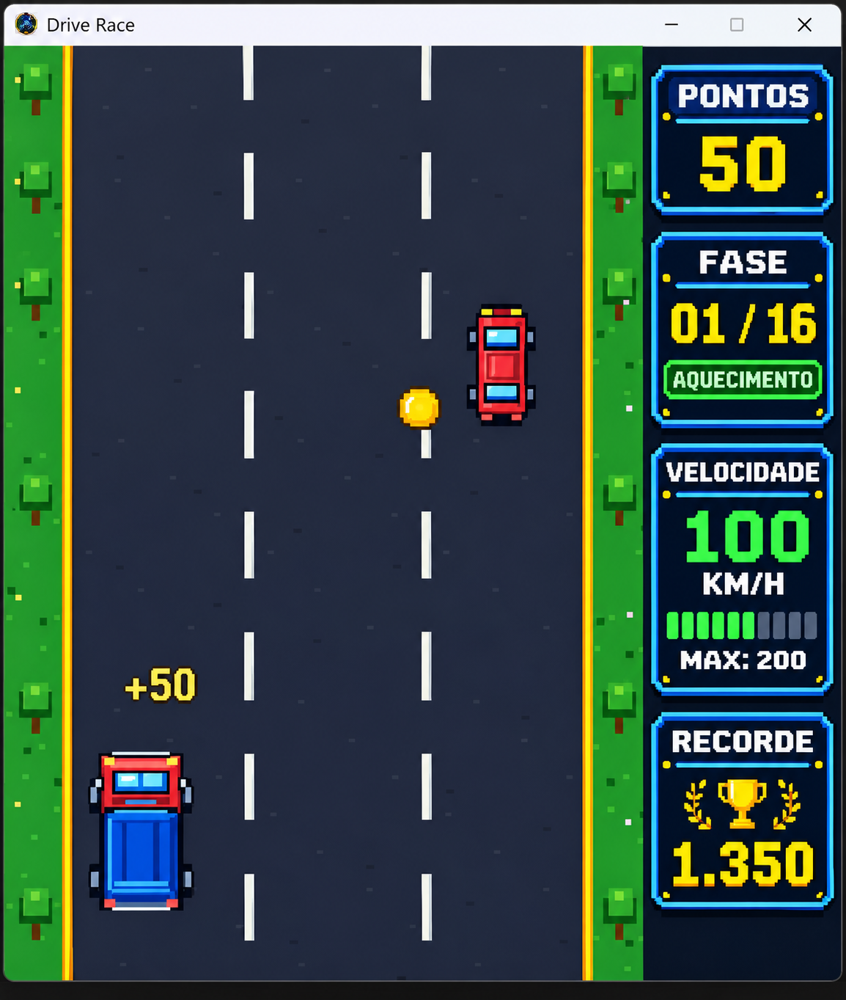
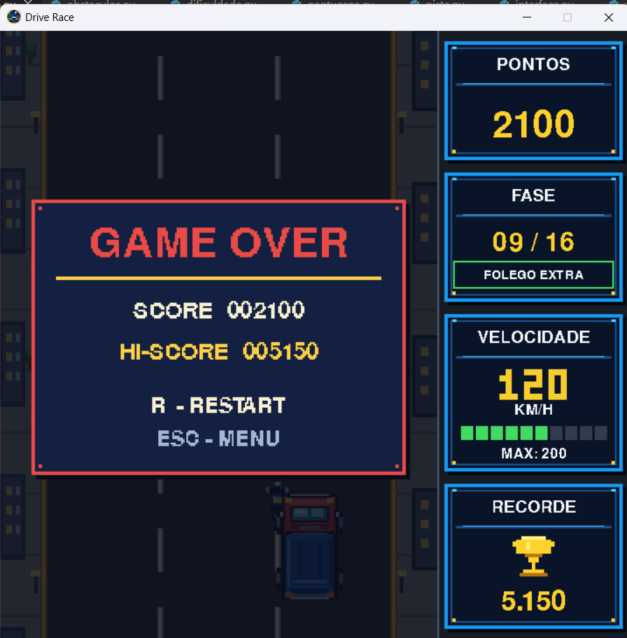

<div align="center">

# 🚛 DRIVE RACE

### A estrada não perdoa. Seu recorde também não.

**Um arcade de sobrevivência sobre rodas, desenvolvido em Python e Pygame, com visual inspirado nos clássicos de 8 bits.**


**[Gameplay](#-o-jogo-em-ação) · [Recursos](#-o-que-te-espera-na-pista) · [Como jogar](#-como-jogar) · [Instalação](#-instalação-e-execução) · [Criar EXE](#-gerando-o-executável-para-windows-exe)**

</div>

---

## 🎮 O jogo em ação

> **Capturas reais do Drive Race**, feitas durante a execução do jogo. Não são artes conceituais.

### 🌲 Estrada rural

O início da jornada: asfalto, árvores pixeladas, moedas e tráfego. À direita, o HUD mostra **pontos, fase, velocidade e recorde**.



### 🌃 Cidade noturna e Game Over

Com a progressão, a paisagem muda para a cidade. O desafio continua — até a próxima colisão!



---

## 🏁 Sobre o Drive Race

Você dirige um **caminhão** em uma estrada de três faixas. Desvie de carros e motos, evite buracos e colete moedas para aumentar a pontuação. A dificuldade cresce conforme você avança, e alguns veículos podem surpreender com mudanças de faixa.

**Atenção:** ultrapassar veículos não dá pontos. Para subir no placar, é preciso **coletar moedas e sobreviver**.

## ✨ O que te espera na pista

| Recurso | Como funciona |
| :--- | :--- |
| 🚛 **Caminhão controlável** | Movimentação lateral entre as faixas da estrada. |
| 🚗 **Carros vermelhos** | Obstáculos que seguem em linha reta. |
| 🚙 **Carros azuis** | Podem mudar de faixa e sinalizam a manobra. |
| 🏍️ **Motocicletas** | Passam a realizar manobras nas etapas mais avançadas. |
| 🕳️ **Buracos** | Novos perigos que exigem atenção à pista. |
| 🪙 **Moedas** | Coletáveis de diferentes valores, inclusive especiais. |
| 🌲 **Cenário rural** | Vegetação e árvores em pixel art. |
| 🌃 **Cenário urbano** | Cidade noturna com edifícios, calçadas e postes. |
| 📊 **HUD arcade** | Cards de pontos, fase, velocidade e recorde. |
| 🏆 **Recorde local** | Melhor pontuação armazenada entre partidas. |

## 🕹️ Como jogar

| Tecla | Ação |
| :---: | :--- |
| `←` / `→` | Mover o caminhão para a esquerda ou direita |
| `Enter` | Iniciar pelo menu |
| `R` | Reiniciar após o Game Over |
| `Esc` | Voltar ao menu após o Game Over |

**Objetivo:** desviar dos perigos e coletar o máximo de moedas possível. Uma colisão encerra a partida.

## 📈 Progressão do desafio

O jogo tem **16 fases**, com mudança de etapa a cada **250 pontos**. Entre os marcos de jogabilidade:

| Pontuação | O que muda |
| :---: | :--- |
| **0–249** | Primeiros obstáculos: carros vermelhos. |
| **250–499** | Carros azuis começam a mudar de faixa. |
| **500–749** | Motocicletas entram no trânsito. |
| **750–999** | Buracos e chegada ao ambiente urbano. |
| **1.000–1.249** | Carros azuis aparecem com mais frequência. |
| **1.250+** | Motocicletas também passam a mudar de faixa. |

A dificuldade segue evoluindo nas fases posteriores. **A 16ª fase é a última configuração de dificuldade**, mas a partida pode continuar enquanto você conseguir sobreviver.

## 🛠️ Tecnologias

- **Python 3** — lógica e organização modular do jogo.
- **Pygame** — renderização, eventos, movimentação, colisões e interface.
- **JSON** — persistência do recorde local.
- **PyInstaller** — empacotamento do jogo como executável para Windows.

### 📦 Bibliotecas do ambiente de desenvolvimento

O ambiente utilizado no projeto já conta com **PyInstaller instalado**. Estas são as versões informadas para o ambiente atual:

| Biblioteca | Versão |
| :--- | :--- |
| `altgraph` | `0.17.5` |
| `packaging` | `26.3` |
| `pefile` | `2024.8.26` |
| `pygame` | `2.6.1` |
| `pyinstaller` | `6.22.3` |
| `pyinstaller-hooks-contrib` | `2026.9` |
| `pywin32-ctypes` | `0.2.3` |
| `setuptools` | `84.2.1` |

> **Importante:** a tabela registra as bibliotecas do ambiente informado, não garante que estejam instaladas automaticamente em outros computadores. O PyInstaller é necessário para **criar** o `.exe`, mas não para **executar** um `.exe` já empacotado.

## 🚀 Instalação e execução

**Pré-requisitos:** Python 3 instalado e acesso a um terminal.

### 1. Clonar o projeto

```bash
git clone https://github.com/sarmanhodev/drive-race.git
cd drive-race
```

### 2. Criar um ambiente virtual

**Windows (PowerShell):**

```powershell
py -m venv .venv
.\.venv\Scripts\Activate.ps1
```

**Linux / macOS:**

```bash
python3 -m venv .venv
source .venv/bin/activate
```

### 3. Instalar as dependências

```bash
python -m pip install -r requirements.txt
```

Para confirmar se o PyInstaller está disponível no ambiente ativo:

```bash
python -m PyInstaller --version
```

Caso não esteja instalado, execute:

```bash
python -m pip install pyinstaller pyinstaller-hooks-contrib
```

### 4. Iniciar o jogo

```bash
python main.py
```

> O jogo utiliza o arquivo `assets/icone.png` como ícone da janela. Mantenha a pasta `assets` junto aos arquivos Python.

---

## 🪟 Gerando o executável para Windows (.exe)

Com o **PyInstaller**, é possível distribuir o Drive Race para computadores Windows sem exigir que o jogador instale Python ou Pygame.

> **Faça a compilação no Windows.** O PyInstaller não funciona como compilador cruzado: para gerar um `.exe` do Windows, execute-o em um ambiente Windows.

### 1. Abra o terminal na raiz do projeto

Acesse a pasta que contém `main.py` e `assets/`:

```powershell
cd caminho\para\drive-race
```

Se estiver utilizando o ambiente virtual, ative-o:

```powershell
.\.venv\Scripts\Activate.ps1
```

### 2. Confira o PyInstaller

Como o ambiente de desenvolvimento já inclui **PyInstaller 6.22.3**, normalmente não é preciso instalá-lo novamente:

```powershell
python -m PyInstaller --version
```

Se o comando não funcionar no ambiente ativo:

```powershell
python -m pip install pyinstaller pyinstaller-hooks-contrib
```

### 3. Limpe os arquivos de compilação anteriores (opcional)

Se já tentou gerar o executável, remova as pastas de saída antigas:

```powershell
Remove-Item -Recurse -Force build, dist -ErrorAction SilentlyContinue
Remove-Item -Force "Drive Race.spec" -ErrorAction SilentlyContinue
```

Isso **não apaga o código-fonte** nem os arquivos do jogo.

### 4. Gere primeiro a versão de teste (`--onedir`)

Recomendamos começar pelo modo **`--onedir` com console**, pois facilita o diagnóstico de erros relacionados a DLLs:

```powershell
python -m PyInstaller --clean --noconfirm --onedir --console --name "Drive Race" --add-data "assets;assets" main.py
```

O resultado ficará em:

```text
dist/
└── Drive Race/
    ├── Drive Race.exe
    └── _internal/          # Bibliotecas e recursos necessários
```

Execute pelo PowerShell:

```powershell
& ".\dist\Drive Race\Drive Race.exe"
```

**Atenção:** no modo `--onedir`, não distribua apenas o `.exe`. A pasta inteira `dist/Drive Race/` precisa acompanhar o executável.

### 5. Gere um único arquivo (`--onefile`)

Depois que a versão de teste funcionar, crie o executável único, sem janela de terminal:

```powershell
python -m PyInstaller --clean --noconfirm --onefile --windowed --name "Drive Race" --add-data "assets;assets" main.py
```

O arquivo será criado em:

```text
dist/
└── Drive Race.exe
```

Agora é possível abrir o jogo com **dois cliques**.

### 6. Personalize o ícone do `.exe` (opcional)

O arquivo `assets/icone.png` é usado como ícone **da janela do Pygame**. Para personalizar o ícone **do executável no Windows**, prepare também um arquivo `.ico`, por exemplo `assets/icone.ico`.

Depois, acrescente `--icon` ao comando:

```powershell
python -m PyInstaller --clean --noconfirm --onefile --windowed --name "Drive Race" --icon "assets/icone.ico" --add-data "assets;assets" main.py
```

### 7. Confira o jogo antes de distribuir

Verifique se:

- O menu inicial abre normalmente.
- A pista, os cenários, os obstáculos e as moedas são exibidos.
- Os cards de **PONTOS, FASE, VELOCIDADE e RECORDE** aparecem corretamente.
- As teclas de movimento e reinício funcionam.
- O recorde permanece salvo após fechar e abrir o jogo novamente.

> **Sobre o recorde:** o jogo usa `recorde.json`. Para uma distribuição definitiva, é recomendável salvar esse arquivo em uma pasta gravável e persistente do usuário (como `%LOCALAPPDATA%\DriveRace`), evitando depender do diretório temporário usado pelo `--onefile`. Essa adaptação deve ser feita no código de persistência caso ainda não tenha sido implementada.

### ⚠️ Solução de problemas: erro de DLL / ordinal não encontrado

Se o Windows apresentar mensagens como **“Número ordinal não encontrado”** ou **“Não foi possível localizar o número ordinal 380”**, pode haver incompatibilidade em alguma DLL carregada durante a inicialização.

1. Atualize as ferramentas de empacotamento:

   ```powershell
   python -m pip install --upgrade pyinstaller pyinstaller-hooks-contrib
   ```

2. Limpe as saídas anteriores e refaça a compilação com `--clean`.
3. Teste primeiro a versão **`--onedir --console`** apresentada acima.
4. Se o erro persistir, registre as versões instaladas:

   ```powershell
   python --version
   python -m pip show pygame
   python -m pip show pyinstaller
   ```

O erro de ordinal **não identifica sozinho qual DLL falhou**. Se persistir, será necessário investigar as bibliotecas carregadas; não é recomendado baixar DLLs aleatórias de sites externos.

### 🧩 Entenda os principais parâmetros

| Parâmetro | Finalidade |
| :--- | :--- |
| `--onedir` | Gera uma pasta com o `.exe` e suas dependências. |
| `--onefile` | Empacota o aplicativo em um único `.exe`. |
| `--console` | Mantém o terminal para facilitar o diagnóstico. |
| `--windowed` | Oculta a janela de terminal ao abrir o jogo. |
| `--name "Drive Race"` | Define o nome do executável. |
| `--add-data "assets;assets"` | Inclui os recursos da pasta `assets` no pacote (Windows). |
| `--icon "assets/icone.ico"` | Define o ícone do executável no Windows. |
| `--clean` | Limpa caches de compilação do PyInstaller. |
| `--noconfirm` | Substitui saídas anteriores sem pedir confirmação. |

---

## 📁 Estrutura do projeto

```text
drive-race/
├── assets/              # Ícone e recursos visuais
│   └── screenshots/     # Capturas reais usadas neste README
├── caminhao.py          # Desenho e movimento do caminhão
├── colisao.py           # Verificação de colisões
├── cores.py             # Paleta de cores
├── dificuldade.py       # Configuração das 16 fases
├── interface.py         # Placar, recorde e telas de aviso
├── main.py              # Inicialização e loop do jogo
├── menu.py              # Menu inicial
├── moedas.py            # Coleta e desenho das moedas
├── obstaculos.py        # Carros, motos e buracos
├── pista.py             # Pista, floresta e cidade
├── pontuacao.py         # Pontuação e persistência
├── recorde.json         # Recorde salvo localmente
├── requirements.txt     # Dependências
├── velocidade.py        # Progressão da velocidade
└── velocimetro.py       # Cards de fase e velocidade
```

> As pastas `build/`, `dist/` e o arquivo `Drive Race.spec` podem surgir após a compilação com PyInstaller.

## 🔮 Próximos passos

O Drive Race continua em desenvolvimento. Algumas ideias para futuras versões são novos cenários, ajustes de equilíbrio e a publicação de uma versão executável para Windows na seção **Releases** do GitHub.

---

<div align="center">

### 🏆 Até onde você consegue chegar?

**Desenvolvido por [sarmanhodev](https://github.com/sarmanhodev) com Python, Pygame e muita vontade de sobreviver ao trânsito.** 🚛💨

</div>
